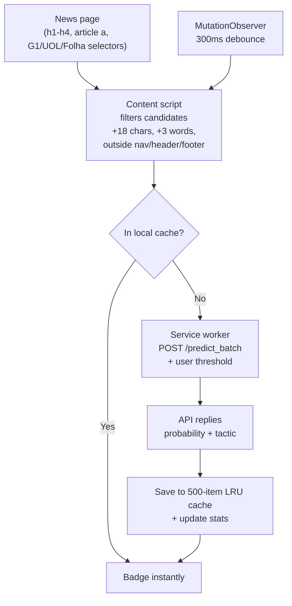
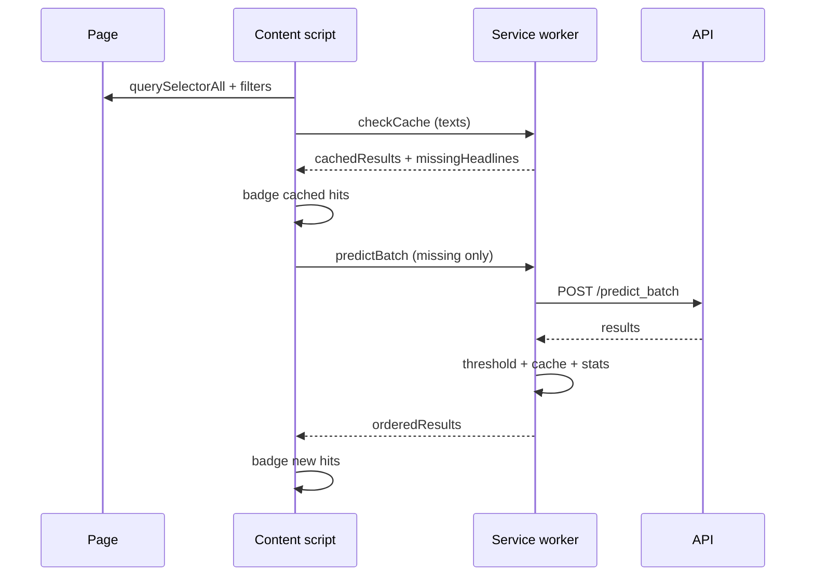

# QuestionAI — Clickbait Detector

*Languages: [Português](README.md) · **English***

<p align="center">
  
</p>

Chrome extension (Manifest V3) that detects clickbait headlines in real
time with AI. Works on any news site: it reads the page headlines, asks
the [QuestionAI API](https://github.com/gu-css/QuestionAI-api), and flags
sensationalist titles on the spot.

## What it does on the page

- **Headline badge**: clickbait titles get a visual highlight with the tactic used (e.g. *"Curiosidade e Segredos"*).
- **Image blur**: the article's main photo is blurred together with the title.
- **Tooltip**: hovering shows the AI's certainty and the detected tactic.
- **Click warning**: clicking a clickbait headline opens a warning modal ("You are about to open a manipulative story…") with an option to continue anyway.

## How it works



The content script runs at `document_idle` and watches DOM changes (SPAs
and infinite scroll). The service worker proxies the API — bypassing page
CSP and mixed-content — and re-applies the threshold on every read, so
moving the slider reclassifies the cache with no new request. Repeated
headlines on the same page (e.g. `h1` + card link) are matched by
position, so each occurrence gets badged.

### Scan sequence



## Install (development)

1. Open `chrome://extensions` and enable **developer mode**.
2. Click **"Load unpacked"** and select this folder.
3. Pin the extension and open the popup to configure the API.

## Quick install (Chrome Web Store)

[](https://chrome.google.com/webstore/detail/questionai-clickbait-detector/placeholder-id)

*Not yet published. To install right now, follow the steps above.*

## Settings (popup)

| Setting | Default | Stored in |
|---------|---------|-----------|
| API URL | `https://clickbait-api.onrender.com` (use `http://localhost:8000` for a local API) | `chrome.storage.local.apiUrl` |
| Threshold (slider) | 75% | `threshold` |
| Model | `kmeans` (`hdbscan` if the API has it) | `model` |
| Global on/off | on | `enabled` |
| Disable on this site | — | `disabledSites` (by hostname) |
| Statistics | — | `stats` (`totalScanned`, `clickbaitDetected`) |
| Headline cache | 500-item LRU | `headlineCache` |

Legacy URLs (`hf.space`, `sua-api`) auto-migrate to the default.
**Clear cache** wipes `headlineCache` without touching stats.

### About the threshold

The server flags clickbait at probability ≥ 0.5, but the extension
re-labels with your slider (default 75%): only what passes your filter
gets badged. It's a display filter — the original probability stays
cached.

## API contract

- `GET /health` → `{status, supervised_loaded, ...}`
- `POST /predict_batch` → `{headlines: [...], model}` → `{results, total}`
- Each item: `headline, is_clickbait, clickbait_status, probability, confidence, bait_type`

## Structure

```text
manifest.json                  # MV3: permissions, content scripts, popup
background/service-worker.js   # API proxy, LRU cache, threshold, stats
content/
  content.js                   # Scanning, filters, badge, blur, tooltip, modal
  content.css                  # .clickbait-detected, .clickbait-image-blurred, modal
popup/
  popup.html / popup.js / popup.css  # Settings and stats
  logo.svg                     # QuestionAI brand — um produto plano b
  simbolo.svg                  # Q symbol
icons/                         # icon16/48/128.png
```

Permissions: `storage` (config/cache/stats), `activeTab` (per-site
toggle), and `host_permissions` for the API (localhost + `*.onrender.com`).
The content script only reads headline text — nothing you type is
collected; texts go to the configured API, by design of the product.
