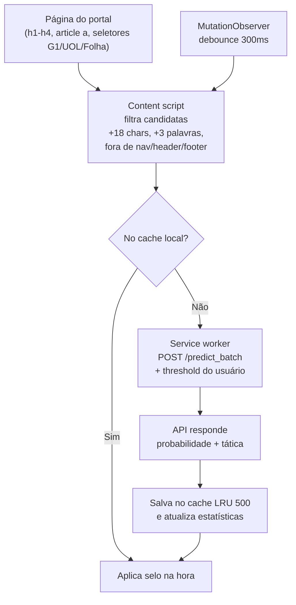
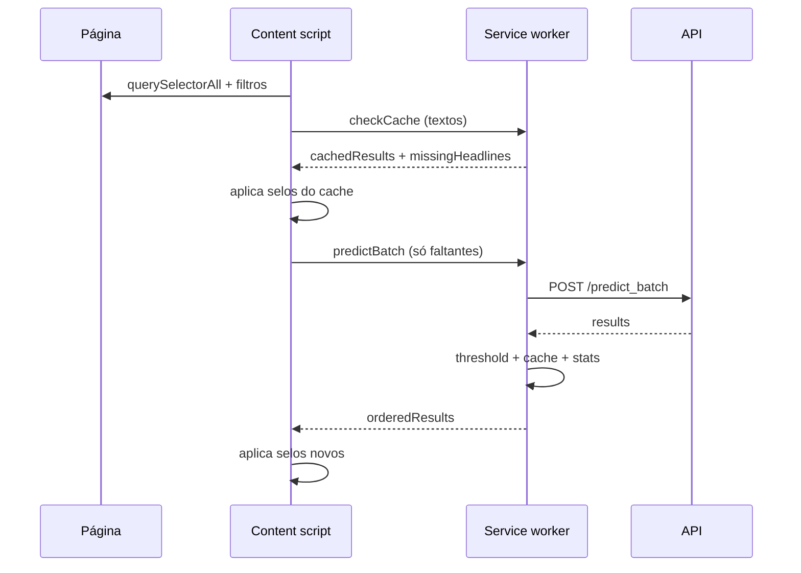

# QuestionAI — Detector de Clickbait

*Idiomas: **Português** · [English](README-en.md)*

<p align="center">
  
</p>

Extensão para Chrome (Manifest V3) que detecta manchetes clickbait em tempo
real, com Inteligência Artificial. Funciona em qualquer portal de notícias:
lê as manchetes da página, consulta a
[QuestionAI API](https://github.com/gu-css/QuestionAI-api) e marca na hora
o que for sensacionalista.

## O que ela faz na página

- **Selo na manchete**: títulos clickbait ganham destaque visual com a tática usada (ex. *"Curiosidade e Segredos"*).
- **Desfoque da imagem**: a foto principal da notícia é borrada junto com o título.
- **Tooltip**: passar o mouse mostra a certeza da IA e a tática detectada.
- **Alerta de clique**: clicar numa manchete clickbait abre um modal de aviso ("Você está prestes a abrir uma notícia manipulativa…") com opção de continuar mesmo assim.

## Como funciona



O content script roda em `document_idle` e observa mudanças no DOM (SPA e
feed infinito). O service worker age como proxy da API — isso contorna
CSP da página e mixed-content — e reaplica o threshold toda vez que a
resposta é lida, então mudar o slider reclassifica o cache sem nova
consulta. Manchetes repetidas na mesma página (ex. `h1` + link do card)
são tratadas por posição, cada ocorrência ganha o selo.

### Sequência de uma varredura



## Instalação (desenvolvimento)

1. Abra `chrome://extensions` e ative o **modo desenvolvedor**.
2. Clique em **"Carregar sem compactação"** e selecione esta pasta.
3. Fixe a extensão na barra e abra o popup para configurar a API.

## Como funciona


O content script roda em `document_idle` e observa mudanças no DOM (SPA e feed infinito). O service worker age como proxy da API — isso contorna CSP da página e mixed-content — e reaplica o threshold toda vez que a resposta é lida, então mudar o slider reclassifica o cache sem nova consulta. Manchetes repetidas na mesma página (ex. `h1` + link do card) são tratadas por posição, cada ocorrência ganha o selo.

## Sequência de uma varredura


| Ajuste | Padrão | Onde fica salvo |
|--------|--------|-----------------|
| URL da API | `https://clickbait-api.onrender.com` (use `http://localhost:8000` p/ API local) | `chrome.storage.local.apiUrl` |
| Limiar (slider) | 75% | `threshold` |
| Modelo | `kmeans` (`hdbscan` se a API tiver) | `model` |
| Ativar/desativar geral | ativada | `enabled` |
| Desativar neste site | — | `disabledSites` (por hostname) |
| Estatísticas | — | `stats` (`totalScanned`, `clickbaitDetected`) |
| Cache de manchetes | LRU de 500 itens | `headlineCache` |

URLs antigas (`hf.space`, `sua-api`) migram sozinhas para o padrão.
O botão **limpar cache** zera o `headlineCache` sem mexer nas estatísticas.

### Sobre o limiar

O servidor marca clickbait com probabilidade ≥ 0,5, mas a extensão
reclassifica com o seu slider (padrão 75%): só vira selo o que passa do
seu filtro. É um filtro de exibição — a probabilidade original continua
guardada no cache.

## Contrato com a API

- `GET /health` → `{status, supervised_loaded, ...}`
- `POST /predict_batch` → `{headlines: [...], model}` → `{results, total}`
- Cada item: `headline, is_clickbait, clickbait_status, probability, confidence, bait_type`

## Estrutura

```text
manifest.json                  # MV3: permissões, content scripts, popup
background/service-worker.js   # Proxy da API, cache LRU, threshold, stats
content/
  content.js                   # Varredura, filtros, selo, blur, tooltip, modal
  content.css                  # .clickbait-detected, .clickbait-image-blurred, modal
popup/
  popup.html / popup.js / popup.css  # Configurações e estatísticas
  logo.svg                     # Marca QuestionAI — um produto plano b
  simbolo.svg                  # Símbolo Q
icons/                         # icon16/48/128.png
```

Permissões: `storage` (config/cache/stats), `activeTab` (alternar por
site) e `host_permissions` para a API (localhost + `*.onrender.com`).
O content script só lê textos de manchete — nada digitado pelo usuário
é coletado; os textos vão para a API configurada, por definição do
produto.
